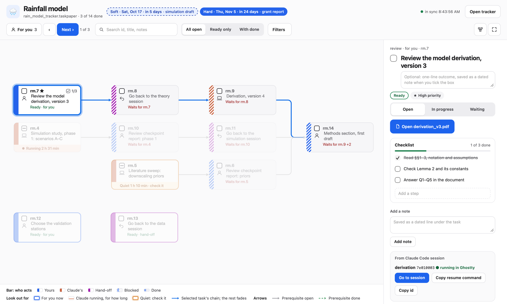
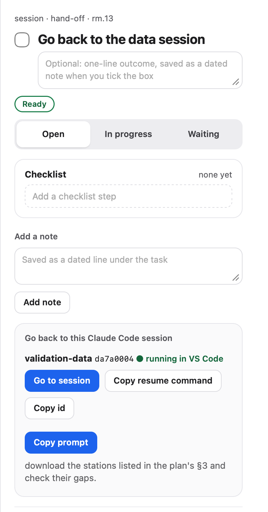
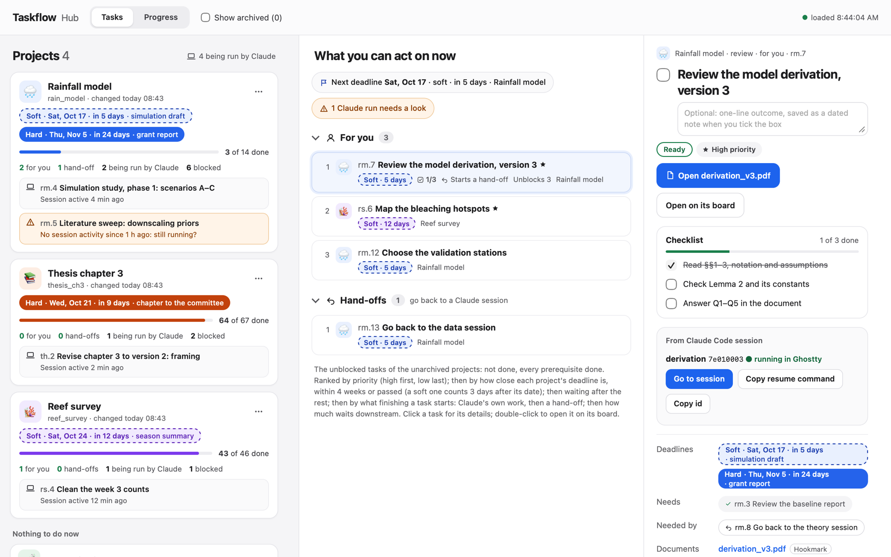
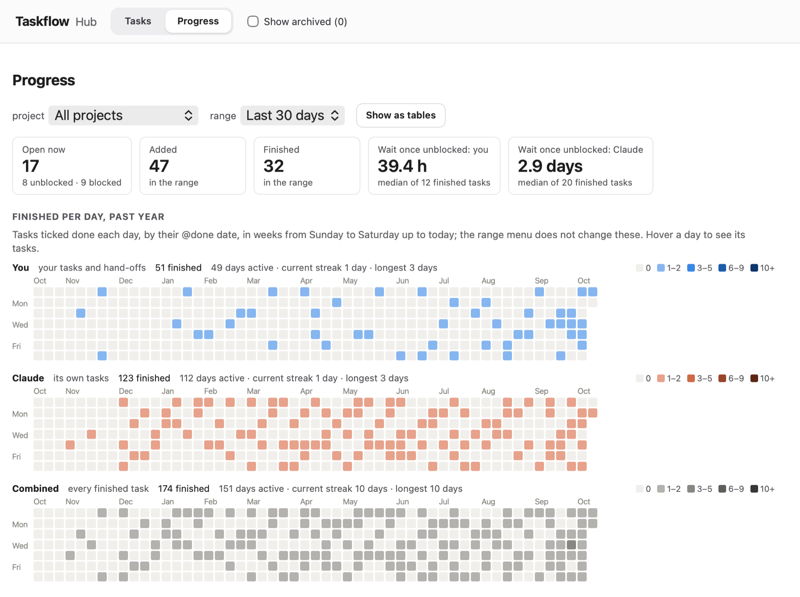
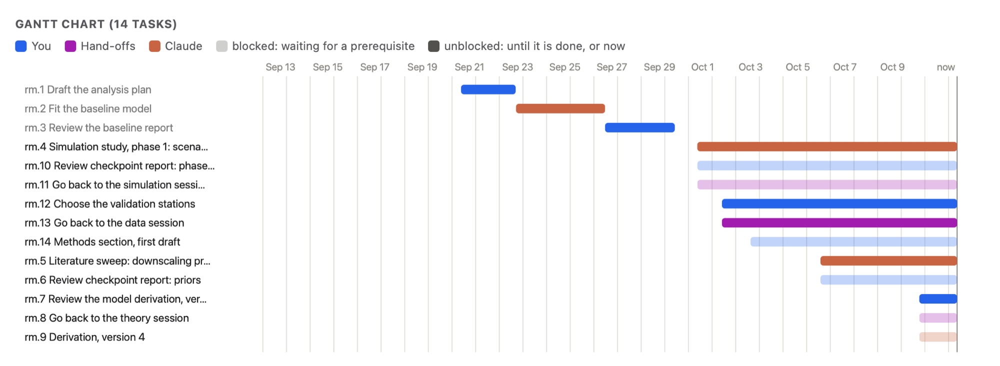

# Taskflow for Research

A plain-text task board for running several Claude Code sessions on one research effort. (The app, the script and its links use the short name Taskflow: `Taskflow.app`, `taskflow.py`, `taskflow://`.) It shows what you need to read, which session to go back to and with what instruction, and what Claude is running, drawn as a dependency graph you can tick off.


*All screenshots show made-up demo projects.*

**Status:** a personal tool, shared as is. It runs on macOS and is built around one person's way of working. It is not maintained for other setups, and parts of it read Claude Code's own files, which can change with any Claude Code update. Issues and pull requests may go unanswered.

**Disclaimer:** Taskflow for Research grew from my own idea and my own way of working, but most of its code was written by Claude Code. Anyone using it does so at their own risk: it comes with no warranty of any kind (see `LICENSE`). The best way to use this repository may be as an illustration of the ideas, from which to build your own workflow and framework.

## Why

Running several Claude Code sessions in parallel on one project is productive until you lose track: which session is waiting for you, which document you still have to read, which cluster job has finished, which session to resume and what to tell it. Taskflow keeps all of that in one TaskPaper file per effort, a plain-text file that you, every session and the board all edit:

- **Review items** for each document a session writes for you, with its questions inside the document.
- **Hand-offs** back to a named session, with its resume command and a ready-to-paste prompt.
- **Work packages and jobs** that Claude runs on its own. Cluster (SLURM) and local jobs close themselves when they finish, through Claude Code hooks, and open a review of their results.
- **`@needs`** between them, so the board shows what is ready and what waits, and ranks what you can do now by what finishing it starts.
- **Checkpoint reports.** At intermediate steps, the related sessions coordinate through the `session-huddle` skill and send you one report with a numbered list of decisions, instead of each session asking separately.

Most tools for running parallel coding agents centre on code: branches, pull requests, merging. Taskflow is for research work, where the unit is a document to read, a decision to make and a job to wait for.

## How it works


1. A session finishes a piece of work, here phase 1 of a simulation study. Through `taskflow.py` it ticks its task and adds two more: a review of its report for you, and a hand-off back to itself that needs the review.
2. The board and the hub draw the tracker: the review is ready for you, and the hand-off waits for it. What you change there (ticks, steps, notes, status) goes back into the file.
3. You read the report, answer its questions in the document, and tick the review. The hand-off is now ready.
4. You go back to the session (**Go to session**, or its resume command) and paste the prompt it left. It runs phase 2, and the board shows it running.

Steps 3 and 4 on the board: open a review (its chain stays bright), tick a step of its checklist (written straight into the tracker), Go to session, then a hand-off with its prompt to paste.


## What is in the repository

| Path | What it is |
|---|---|
| `taskflow.py` | The command line and the local web servers (Python 3 standard library only). |
| `static/index.html` | The board: one tracker as a dependency graph (Cytoscape.js with dagre). |
| `static/hub.html` | The hub: every tracker on one page, your unblocked tasks across them, what Claude is running, and a Progress view. |
| `progress.py` | The Progress view's Gantt chart and activity calendars. |
| `macapp/` | An optional macOS app: one window per tracker, the hub on every desktop, `taskflow://` links. |
| `templates/tracker_template.taskpaper` | The starting point for a new tracker. |
| `skills/taskflow-tracker/` | The Claude Code skill that teaches sessions the tracker's conventions. |
| `skills/session-huddle/` | A Claude Code skill for coordinating several open sessions through cross-session messages. |
| `test_taskflow.py`, `tests/browser/` | Python tests, and WebKit tests of the board, the hub and the Progress view. |

## Quick start

You need macOS, Python 3.9 or later (developed with 3.11; the Python tests also pass on macOS's own 3.9) and Claude Code. Optional: the TaskPaper app, Hookmark (document links that survive moving files), Ghostty or VS Code (for Go to session), and Xcode's command line tools (for the app, which needs macOS 13 or later, and for the browser tests).

```sh
git clone <this repository> TaskflowForResearch && cd TaskflowForResearch
python3 taskflow.py ~/work/my_effort/my_effort_tracker.taskpaper --init --title "My effort" --prefix ab --emoji 🧬
```

Then run each of these in its own terminal window: each serves its page until you press Ctrl-C.

```sh
python3 taskflow.py ~/work/my_effort/my_effort_tracker.taskpaper --open      # the board, in your browser
python3 taskflow.py --hub --open                                               # the hub, over every tracker you have made
```

Optional, the Mac app, which runs both for you (it uses python.org's Python 3.11 if installed, else the `python3` on your PATH; `PYTHON=/path/to/python3` picks another):

```sh
macapp/build_app.sh --install                                                   # builds it and puts it in ~/Applications
```

Then give your Claude Code sessions the conventions: copy `skills/taskflow-tracker` and `skills/session-huddle` into `~/.claude/skills/`, and in the copy, `~/.claude/skills/taskflow-tracker/SKILL.md`, replace `<your taskflow folder>` with this folder's path. The session-huddle skill needs a Claude Code version with the `ListAgents` and `SendMessage` tools, through which sessions on one Mac message each other; without them, use taskflow-tracker alone.

To have finished jobs closed automatically, add hooks to `~/.claude/settings.json` that run the sweep whenever a session starts or finishes a reply:

```json
"hooks": {
  "SessionStart": [{ "hooks": [{ "type": "command", "command": "python3 \"/path/to/TaskflowForResearch/taskflow.py\" --sweep-detached 2>/dev/null || true" }] }],
  "Stop":         [{ "hooks": [{ "type": "command", "command": "python3 \"/path/to/TaskflowForResearch/taskflow.py\" --sweep-detached 2>/dev/null || true" }] }]
}
```

Only if you run SLURM cluster jobs: they are checked with `sacct` over ssh, through the host alias `cluster` unless you pass `--host`; set that alias up in `~/.ssh/config`.

What Taskflow keeps of its own lives in this folder: the hub's list of trackers (`trackers.json`, `hub_view.json`), a backup of every edit (`backups/`), the job registry (`jobs/`) and the launchers (`launchers/`). Git ignores them, but `git clean -x` would delete them; and if you move the folder, rebuild the app.

### Without TaskPaper or Hookmark

Neither is needed.

- **TaskPaper** is only one way to edit a tracker by hand. A tracker is plain text (tasks are lines starting with `- `, indented with tabs), so any text editor works. Sessions change it through `taskflow.py`, and you through the board and the hub. *Open tracker* opens it in TaskPaper when installed, otherwise in your default text editor.
- **Hookmark** only makes document links survive moving the files. Without it, documents open from their plain `file://` links, and nothing asks for Hookmark links. Taskflow detects Hookmark by itself; when it is installed, `--init` and `--add-hook-links` create Hookmark bookmarks for the documents a tracker links (macOS may ask once to let your terminal control Hookmark). Set `TASKFLOW_HOOKMARK=0` (or `1`) to decide instead.

`python3 test_taskflow.py` includes a fresh-install test that runs this quick start on a clean copy, without Hookmark.

## A tracker

```
My effort tracker:
	- Review simulation report, version 2 @type(review) @owner(me) @id(ab.4) @needs(ab.3) @sessionid(<session id>)
		file:///Users/you/work/my_effort/sim_report_v2.pdf
		Questions: §5, Q1–Q4.
		- Read the methods section
		- Check Table 2 @done(2026-10-11 09:40)
	- Go back to the simulation session @type(session) @owner(me) @session(sims) @id(ab.5) @needs(ab.4) @sessionid(<session id>)
		Prompt: apply the decisions in §5 of the report and rerun scenario B.
	- Rerun scenario B @type(work) @owner(claude) @id(ab.6) @needs(ab.5)
```

An excerpt, for illustration: `<session id>` stands for a real one, and ab.3 is not shown, so `--check` would flag it as it is.

- `@owner(me)` is yours; `@owner(claude)` is work a Claude session runs on its own; `@type(session)` is a hand-off back to a session.
- `@needs` draws the arrows and decides what is ready.
- Indented `- ` lines under a task are its checklist, ticked with `@done`.
- `@status(inprogress)`, `@done(…)`, `@priority(high)`, and the project's `@harddeadline` and `@softdeadline` on the first line, do what their names say. `skills/taskflow-tracker/SKILL.md` has the full rules.

## The board

One tracker, as a dependency graph (the picture at the top). A card's bar says who acts: blue for you, clay for Claude, purple for a hand-off. Its fill and outline say where it stands:


- What you can do **now** is outlined in its colour; **Next** (key `n`) steps through those in their ranked order.
- **Blocked** cards turn grey, their bar striped, until what they need is done; **done** tasks shrink to slim chips, shown with *With done*.
- **Claude's running work** says how long it has run, and turns amber when its session has been quiet for an hour.
- **Checklists:** a task's steps are indented `- ` lines under it. Add them in the board's panel (*Add a step*) or have a session write them; tick them on the board, in the hub or in TaskPaper. A card shows its progress at the top right (☑ 1/3).



**Selecting a card** keeps its whole chain (what it needs, and what waits on it) bright and fades the rest. The panel shows its documents, checklist, notes and session (with **Go to session** while the session runs, and its resume command), and lets you change its status, needs and notes. Every change goes straight into the file, after a conflict check, with a backup.

### Hand-offs



A hand-off is a task for you: go back to a Claude Code session and give it an instruction. Sessions add them when they need you, usually after a review, so a hand-off waits until you tick the review. Its panel names the session and gives three ways back:

- **Go to session**, while the session runs: brings its Ghostty tab or VS Code window to the front.
- **Copy resume command** (`cd <its folder> && claude --resume <id>`), once it has closed.
- **Copy prompt**: the instruction the session left, ready to paste.

<br clear="right">

## The hub



- **Projects** (left): one card per tracker, with its deadlines (dashed: soft, internal; solid: hard, external), its progress, and the Claude tasks running in it, flagged when their session has gone quiet.
- **What you can act on now** (middle): your unblocked tasks and hand-offs across every project, ranked by priority; then, within each priority, by how much finishing them frees Claude to work (each Claude task waiting on one counts 1, shared among everything that task still waits for, and a hand-off half that), so Claude's sessions are not left idle; then by how close the project's deadline is; then by what else finishing them starts.
- **The task you clicked** (right): its documents, checklist and session; tick it or its steps here, or open it on its board.

## Progress





The hub's Progress view (built from `@added` and `@done`) counts what is open, added and finished, how long tasks wait once they are unblocked, draws calendars of finished tasks per day for you, for Claude and combined, and a Gantt chart of every task.

## Tests

```sh
python3 test_taskflow.py          # the Python tests
tests/browser/run_all.sh          # the board, hub and Progress view in WebKit (needs Xcode's command line tools)
```

## Limits

- macOS only, for the app, the browser tests, document links, Hookmark and Go to session. The board and hub themselves are local web pages and may work elsewhere, untested.
- It reads Claude Code's own files: session transcripts in `~/.claude/projects/` (for session titles and activity) and `~/.claude/sessions/` (for Go to session). These are not documented interfaces. When they change, the affected parts stop working; the rest goes on.
- One user, local only: the servers listen on 127.0.0.1 and refuse requests from other websites (every change needs a token from the page). Other programs on the same Mac can still read your trackers and fetch that token, so use Taskflow on a Mac where you are the only user.
- A document link that would run something (an app, a script, an installer) is shown in Finder, not opened; open it yourself if you trust it. `hook://` links are opened by Hookmark, which this check cannot see into.

## Saying thanks

If you find this useful, you can show your appreciation by forking the repository, so that I know it has helped someone.

## Licence

MIT; see `LICENSE`. The board bundles Cytoscape.js, cytoscape-dagre and dagre (with graphlib and lodash inside it), each under its own MIT licence; their notices are in `static/vendor/LICENSES.txt`.
